# Azure DevOps × Extreme Programming 實戰教學：用一個「點數錢包」走完 XP 的完整回饋循環

> 這份教材不是 Azure DevOps（以下簡稱 ADO）的功能清單。
> 我們跟著一個虛構的零售會員團隊 **PointWallet**，依照 **Extreme Programming（XP）** 的節奏：
> **Release Planning → Iteration Planning → 站立會議 → 測試先行（TDD）× 結對程式設計 → 持續整合 → 小版本發佈 → 客戶驗收 → 回顧**，
> 一步一步操作 ADO。每個步驟都附上實際畫面截圖，說明「這個功能對應到哪個 XP 實踐、解決什麼問題」。

所有截圖都來自 2026 年 10 月實際操作的 Azure DevOps Services（雲端版）。ADO 介面會持續更新，若畫面略有不同，請以功能名稱對照。

---

## 目錄

- [0. 情境與學習地圖](#0-情境與學習地圖)
- [1. Azure DevOps 基礎概念](#1-azure-devops-基礎概念)
- [2. 準備：建立專案與團隊節奏](#2-準備建立專案與團隊節奏)
- [3. Release Planning：客戶寫故事、開發估點](#3-release-planning客戶寫故事開發估點)
- [4. Iteration Planning：拆解工作與永續步調](#4-iteration-planning拆解工作與永續步調)
- [5. 站立會議與資訊看板](#5-站立會議與資訊看板)
- [6. 測試先行（TDD）× 結對程式設計](#6-測試先行tdd-結對程式設計)
- [7. 持續整合與集體程式碼所有權](#7-持續整合與集體程式碼所有權)
- [8. 小版本發佈：Environment 與部署階段](#8-小版本發佈environment-與部署階段)
- [9. 客戶驗收測試（Customer Tests）](#9-客戶驗收測試customer-tests)
- [10. 回饋與改善：Queries、Dashboard、Wiki](#10-回饋與改善queriesdashboardwiki)
- [11. 清理環境](#11-清理環境)
- [附錄 A：用腳本重建本教材環境](#附錄-a用腳本重建本教材環境)
- [附錄 B：常見問題](#附錄-b常見問題)
- [附錄 C：參考資料](#附錄-c參考資料)

---

## 0. 情境與學習地圖

### 0.1 故事背景

**PointWallet** 是一家連鎖零售的會員點數服務。客戶（行銷部門）希望 3 週內上線第一版：**會員消費自動集點、可查詢餘額、可用點數折抵消費**。
團隊採用 XP：**1 週一個 Iteration、3 個 Iteration 組成一個 Release**，所有正式程式碼都以 **結對 + 測試先行** 完成。

| 項目 | 設定 |
|---|---|
| Organization | `cpingwang0948`（請換成你自己的） |
| Project | `PointWallet-XP-Demo` |
| Process（流程範本） | **Agile**（User Story + Story Points，最貼近 XP 的用語） |
| Release 1 | 2026/10/26 – 2026/11/13 |
| Iteration 1 / 2 / 3 | 每週一個（10/26、11/2、11/9 開始） |
| 程式碼 | Node.js 點數錢包服務（本 repo 的 [`sample-app/`](sample-app/)，無任何外部套件） |

### 0.2 XP 實踐 ↔ ADO 功能對照

XP 的核心是 **縮短回饋循環**。下表是整份教材的骨幹：

| XP 實踐 | 回饋循環 | 主要使用的 ADO 功能 | 章節 |
|---|---|---|---|
| Planning Game（Release Planning） | 週 / 月 | Backlogs、Story Points、Forecast、Planning 面板 | 3 |
| Planning Game（Iteration Planning） | 週 | Sprints › Backlog、Capacity、Work details | 4 |
| Sustainable Pace（40 小時工作週） | 週 | Capacity（每日可投入時數） | 4 |
| Whole Team / 資訊看板 | 日 | Taskboard、Board（WIP 限制、欄位完成定義） | 5 |
| Test-First / TDD | 分鐘 | Repos：Commits（RED / GREEN / refactor 紀錄） | 6 |
| Pair Programming | 秒 | commit `Co-authored-by`、Task Tag | 6 |
| Refactoring / Simple Design | 分鐘 | Commit diff、Tag `refactoring`、Queries | 6、10 |
| Continuous Integration | 小時 | Pipelines（CI trigger）、短命分支 + Rebase 合併 | 7 |
| Collective Code Ownership | 小時 | 分支原則（不設專屬擁有者）、PR 可由任何人完成 | 7 |
| Small Releases | 天 / 週 | Pipelines 多階段（Stages）+ Environment | 8 |
| Customer Tests / On-site Customer | 天 | Test Case（Tested By 連結 User Story） | 9 |
| Metaphor / Coding Standard | 持續 | Wiki | 10 |
| Spike（探索） | 時間盒 | User Story + Tag `Spike` + Wiki 結論 | 3、10 |

### 0.3 XP 回饋循環在 ADO 中的樣子

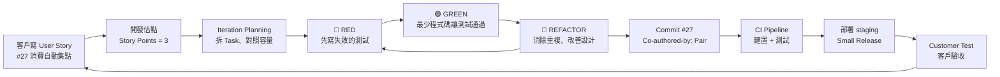

> **學習重點**：ADO 讓「故事 → 測試 → 程式碼 → 建置 → 部署 → 驗收」彼此**互相連結**。點開任何一個 commit 都能看到它屬於哪個 User Story；點開 User Story 也能看到它的測試案例與程式碼。

---

## 1. Azure DevOps 基礎概念

### 1.1 三層結構

| 層級 | 說明 | 本教材範例 |
|---|---|---|
| **Organization** | 最上層，對應網址 `https://dev.azure.com/<org>`，管理帳號、授權、計費 | `cpingwang0948` |
| **Project** | 一個產品或系統，擁有自己的 Boards、Repos、Pipelines… | `PointWallet-XP-Demo` |
| **Team** | 專案中的一群人，擁有自己的 Backlog、Iteration、容量 | `PointWallet-XP-Demo Team`（自動建立） |

> 💡 Work Item ID 是 **Organization 層級**流水號。本教材的 Organization 先前已有其他專案，所以 User Story 編號從 #27 開始；你自己的環境編號會不同。

### 1.2 五大服務

| 服務 | 用途 | XP 中的角色 |
|---|---|---|
| **Boards** | Work Item、Backlog、Iteration、看板、查詢 | Planning Game、資訊看板 |
| **Repos** | Git、Pull Request、分支原則 | TDD、結對、集體所有權 |
| **Pipelines** | CI/CD、Environment | 持續整合、小版本發佈 |
| **Test Plans** | 手動 / 探索式測試 | 客戶驗收測試 |
| **Artifacts** | 套件庫 | 共用元件（本教材不深入） |

### 1.3 為什麼 XP 選 Agile 流程範本？

| Process | 需求項目 | 估算欄位 | 與 XP 的契合度 |
|---|---|---|---|
| Basic | Issue | Effort | 太簡化，缺少 User Story |
| **Agile** | **User Story** | **Story Points** | ✅ XP 原生用語就是 User Story 與 Story Points |
| Scrum | Product Backlog Item | Effort | 可用，但用語偏 Scrum |
| CMMI | Requirement | Size | 流程偏重，與 XP 的輕量精神不合 |

**Agile 範本的 Work Item 與狀態：**

```
Epic（選用）
 └─ Feature                  （Release 範圍）
     ├─ User Story           New → Active → Resolved → Closed
     ├─ Bug                  New → Active → Resolved → Closed
     └─ (User Story / Bug 底下)
         └─ Task             New → Active → Closed   （Remaining Work 以小時計）
```

### 1.4 授權與費用注意事項

| 授權 | 費用 | 說明 |
|---|---|---|
| Stakeholder | 免費 | 適合客戶代表：可看 Backlog、Dashboard，有限度編輯 Work Item |
| Basic | 前 5 位免費 | Boards、Repos、Pipelines、Artifacts 完整功能 |
| Basic + Test Plans | 付費（可試用 30 天） | 完整 Test Plans |

> ⚠️ 新建立的 Organization，Pipelines 的 **Microsoft-hosted 平行作業可能為 0**，第一次執行會失敗。解法見 [7.4](#step-74-第一次執行常見錯誤no-hosted-parallelism)。

---

## 2. 準備：建立專案與團隊節奏

> **XP 情境**：團隊與客戶第一次見面前，Coach 先把協作環境準備好：專案、Release / Iteration 節奏、業務模組（Area）、團隊設定。

### Step 2.1 建立 Agile 專案

1. 進入 `https://dev.azure.com/<your-org>`，點 **New project**（空的 Organization 會直接顯示建立表單）
2. **Project name**：`PointWallet-XP-Demo`；**Description**：描述專案目的
3. **Visibility**：`Private`
4. 展開 **Advanced**：**Version control** = `Git`；**Work item process** = **`Agile`**（⚠️ 預設是 Basic）
5. 點 **Create project**

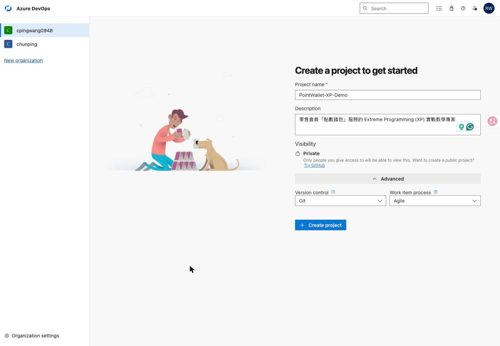

### Step 2.2 建立 Release 與每週 Iteration

XP 的 Planning Game 分兩層：**Release Planning**（數週，決定範圍）與 **Iteration Planning**（1~2 週，決定任務）。ADO 的 Iteration 可以**巢狀**，正好表達這兩層：

1. **Project settings › Boards › Project configuration › Iterations**
2. 選取根節點 › **New child**，建立 `Release 1`（10/26 ~ 11/13）
3. Agile 範本預設的 `Iteration 1~3` 位於根節點下，將它們**拖曳**到 `Release 1` 底下（或在 `Release 1` 上按 **New child** 重新建立）
4. 逐一設定日期：每個 Iteration **1 週**

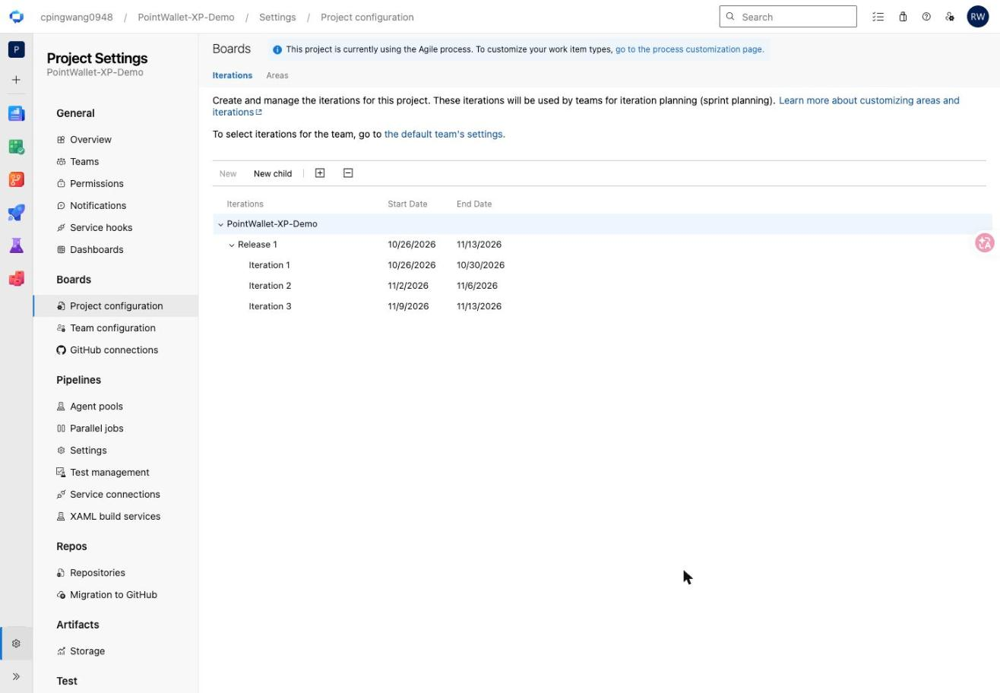

### Step 2.3 選擇團隊參與的 Iteration

**Project settings › Boards › Team configuration › Iterations**：確認團隊選取了 `Release 1\Iteration 1~3`。只有被選取的 Iteration 才會出現在 **Sprints** 頁面與 Planning 面板。

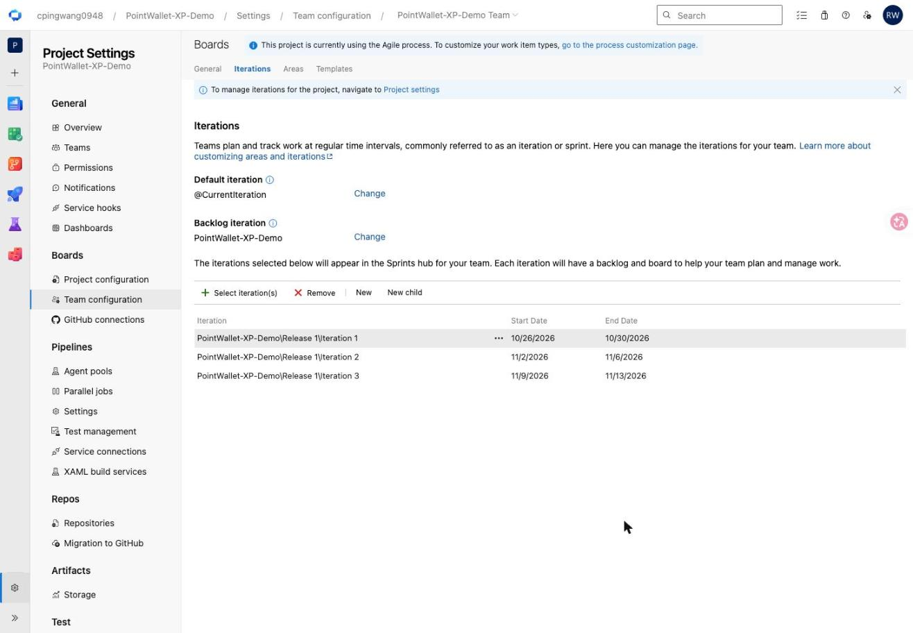

> 💡 **Default iteration** 預設為 `@CurrentIteration`，代表在 Backlog 新增的項目會自動進入目前 Iteration。Feature 這類跨 Iteration 的項目，記得把 Iteration 改成 `Release 1`。

### Step 2.4 建立 Area 並設定團隊

1. 同一頁 **Areas** 頁籤，在根節點下建立 `集點 Earn`、`兌點 Redeem`、`平台 Platform`
2. **Team configuration › Areas**：勾選 **Include sub areas**，子 Area 的項目才會出現在團隊 Backlog

### Step 2.5 團隊設定：Backlog 層級、工作日、Bug 處理方式

在 **Boards › Boards** 右上角齒輪（或 Team configuration › General）：

- **Backlog navigation levels**：保留 `Features` 與 `Stories`（XP 通常不需要 Epic）
- **Working days**：週一到週五（影響容量與燃盡圖）
- **Working with bugs**：改為 **Bugs are managed with requirements**
  - Agile 範本預設是 *managed with tasks*，Bug 不會出現在 Backlog。XP 主張 Bug 也要由客戶排序，所以讓它與 User Story 並列。

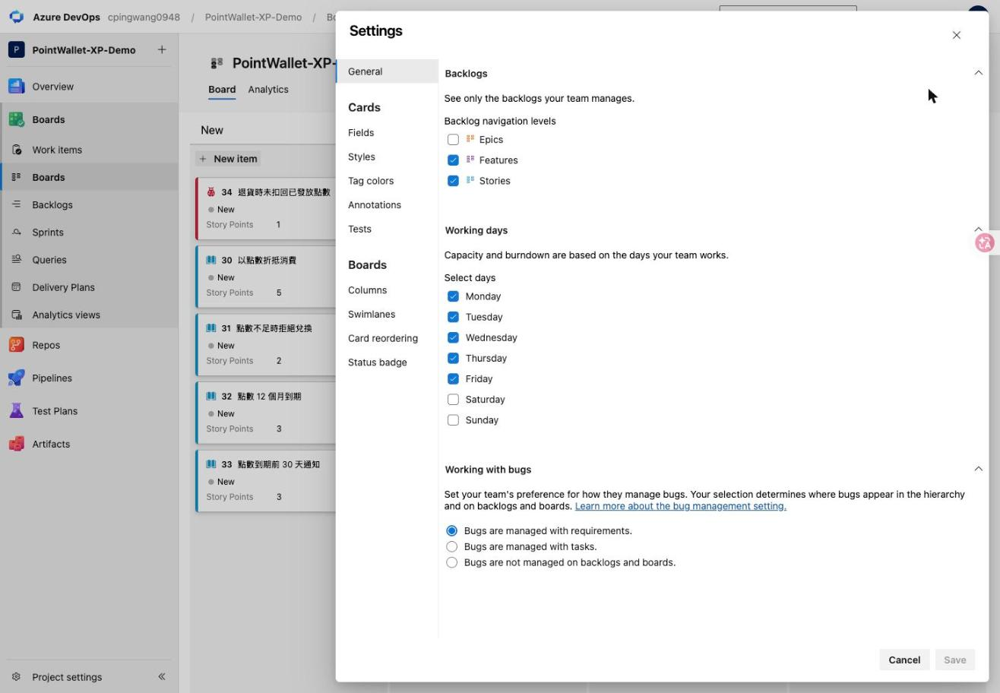

---

## 3. Release Planning：客戶寫故事、開發估點

> **XP 情境**：Planning Game 的規則很簡單：**客戶決定「做什麼、先做什麼」；開發決定「要花多少力氣」**。客戶把需求寫成 User Story，開發估 Story Points，再依團隊速度（Velocity）預測哪些故事能進 Release 1。

### Step 3.1 建立 Feature 與 User Story

**Boards › Backlogs**，右上角層級切到 **Features** 新增三個 Feature（集點 / 兌點 / 點數效期），再切回 **Stories**，用 Feature 列左側的 `+` 新增子項目 User Story。

開啟右上角 **View options（滑桿圖示）› Parents = On**，可看到 Feature → User Story 的階層；右側 **Planning** 面板顯示各 Iteration 已排入的 Story Points（Planned Effort）：

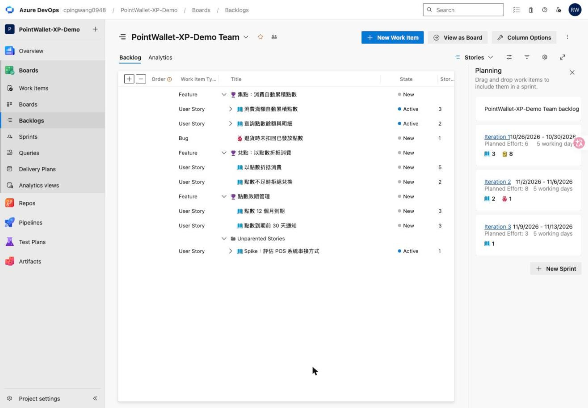

本教材的 Release 1 Backlog：

| Feature | User Story / Bug | Story Points | Iteration |
|---|---|---|---|
| 集點 | #27 消費滿額自動累積點數 | 3 | Iteration 1 |
| | #28 查詢點數餘額與明細 | 2 | Iteration 1 |
| | #34 (Bug) 退貨時未扣回已發放點數 | 1 | Iteration 2 |
| （無） | #29 **Spike**：評估 POS 系統串接方式 | 1 | Iteration 1 |
| 兌點 | #30 以點數折抵消費 | 5 | Iteration 2 |
| | #31 點數不足時拒絕兌換 | 2 | Iteration 2 |
| 點數效期 | #32 點數 12 個月到期 | 3 | Iteration 3 |
| | #33 點數到期前 30 天通知 | 3 | （待排） |

### Step 3.2 撰寫好的 User Story

XP 的 User Story 是「一張卡片 + 一段對話 + 一組確認條件（Card, Conversation, Confirmation）」。在 ADO 表單中：

| 欄位 | 寫法 |
|---|---|
| Title | 動詞開頭的簡短描述 |
| Description | 「身為 *角色*，我想要 *功能*，以便 *價值*」 |
| Acceptance Criteria | 可被測試的條件（之後會變成 Customer Test） |
| Story Points | 開發團隊的相對估算（1、2、3、5、8…） |
| Discussion | 與客戶的對話紀錄，可用 `@人名`、`#工作項目` |
| Related Work | Parent = Feature；Child = Task；Tested By = Test Case |

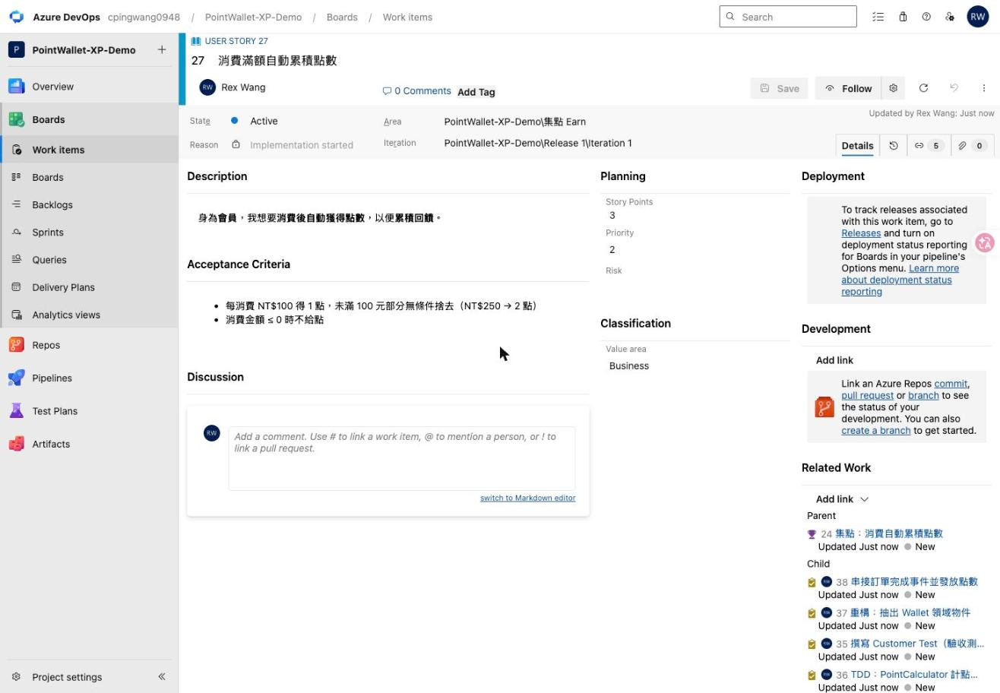

### Step 3.3 用 Spike 處理「估不出來」的故事

當團隊對技術沒把握、無法估點時，XP 用 **Spike**：一個有**時間盒**的探索任務，目標是產出知識而非產品程式碼。

ADO 沒有內建 Spike 類型，常見做法是建立 User Story（或 Task）並加上 **Tag `Spike`**，在 Acceptance Criteria 寫明時間盒與產出物：

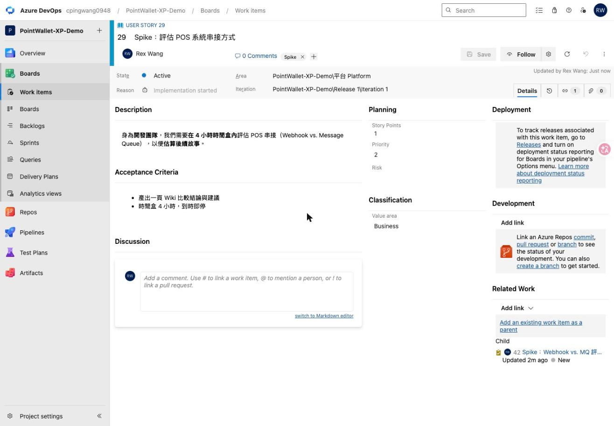

> Spike 完成後，把結論寫進 Wiki（見 [Step 10.3](#step-103-wiki隱喻團隊約定spike-結論)），並據此估算後續故事。

### Step 3.4 用 Forecast 預測 Release 範圍

在 Stories Backlog 開啟 **View options › Forecasting = On**，輸入團隊預估速度（本例 **6 點 / Iteration**）。ADO 會依 Backlog 順序畫出每個 Iteration 的分界線：

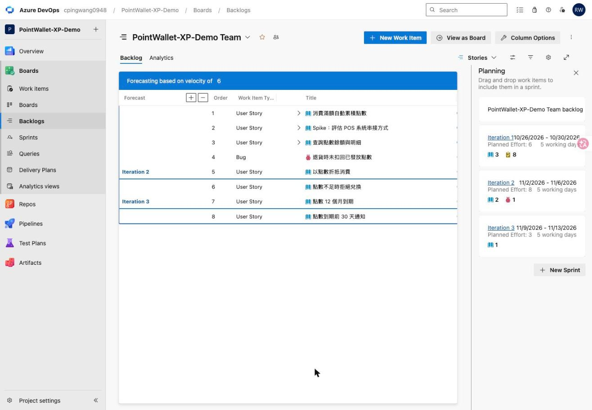

> 這就是 XP 的「昨日天氣（Yesterday's Weather）」原則：用過去實際完成的點數預測未來。客戶看到分界線後，可以直接拖曳調整順序，即時看到哪些故事會被擠出 Release 1。
> 累積幾個 Iteration 後，**Backlogs › Analytics** 或 Dashboard 的 **Velocity** 圖會顯示實際速度，Forecast 的數字就該換成真實數據。

---

## 4. Iteration Planning：拆解工作與永續步調

> **XP 情境**：每週一的 Iteration Planning，開發把本週的故事拆成 **Task（以小時估）**，認領工作，並確認總工時不超過團隊容量。XP 的 **Sustainable Pace** 原則：寧可少承諾，也不靠加班。

### Step 4.1 設定容量（Capacity）

**Boards › Sprints**，選 `Iteration 1` › **Capacity** 頁籤：

- **Activity**：Development
- **Capacity per day**：**6** 小時（扣除會議、溝通、學習時間）
- **Days off**：請假日；**Team days off**：國定假日

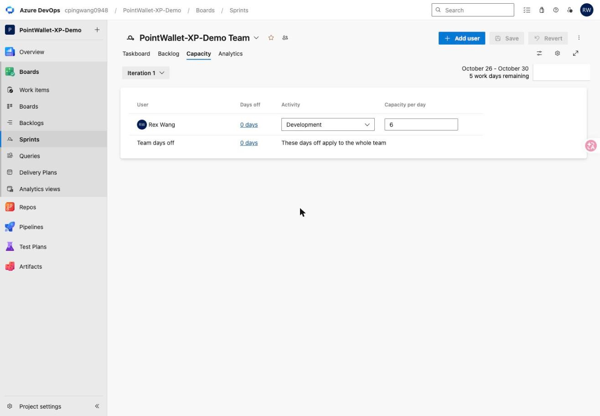

### Step 4.2 拆解 Task，讓「測試」與「重構」成為一等公民

切換到 **Backlog** 頁籤，在每個 User Story 下按 `+` 新增 Task。XP 團隊的 Task 清單會明確包含：

- **撰寫 Customer Test**（Activity = Testing）
- **TDD：實作規則**（Tag `pair-programming`）
- **重構**（Tag `refactoring`）—— 把重構排進計畫，而不是「有空再做」
- **Spike 時間盒**（Activity = Requirements，Tag `Spike`）

開啟 **View options › Side pane › Work details**，即時看到 **22 of 30 h**：總工時在容量內 ✅

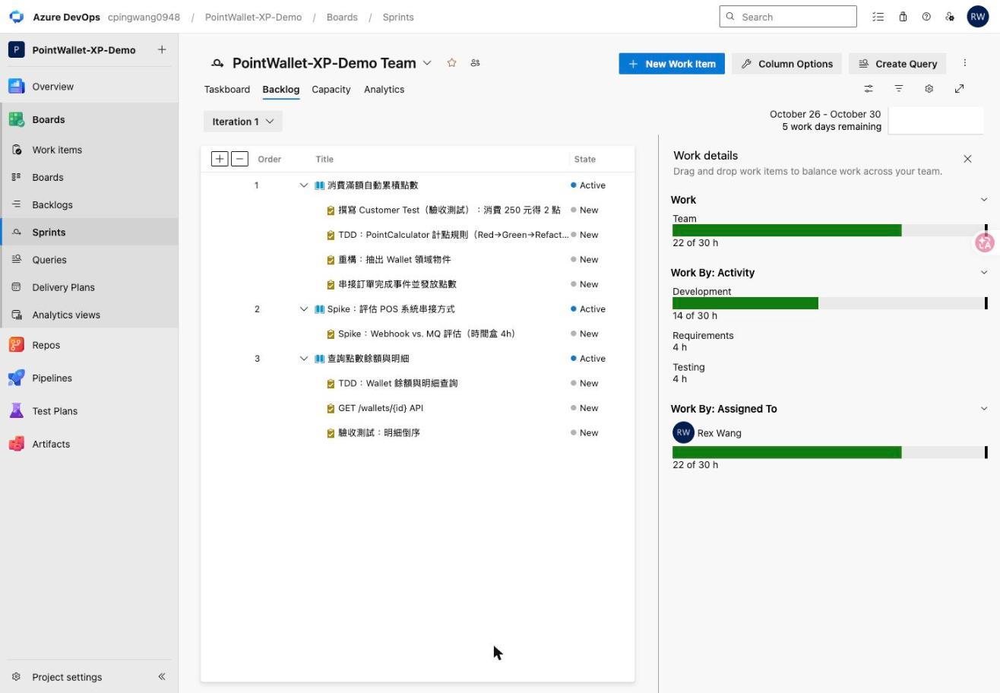

> 若長條變紅（超過容量），就請客戶把一個故事移回 Backlog —— 這是 XP 中客戶與開發「協商範圍」的時刻，而不是要求開發加班。

---

## 5. 站立會議與資訊看板

> **XP 情境**：XP 強調 **Informative Workspace（資訊豐富的工作空間）**：任何人走進團隊區域，10 秒內就能看懂進度。ADO 的看板就是電子版的大白板。

### Step 5.1 Taskboard：每天更新 Task

**Boards › Sprints › Taskboard**。每一列是一個 User Story，欄位是 Task 狀態 **New → Active → Closed**：

1. 認領工作時把卡片拖到 **Active**
2. 更新卡片右下角的 **Remaining Work**
3. 完成時拖到 **Closed**（ADO 規則：Task 關閉時 Remaining Work 必須清空）

卡片上的 Tag（`pair-programming`、`refactoring`、`Spike`）讓站會一眼看出工作性質：

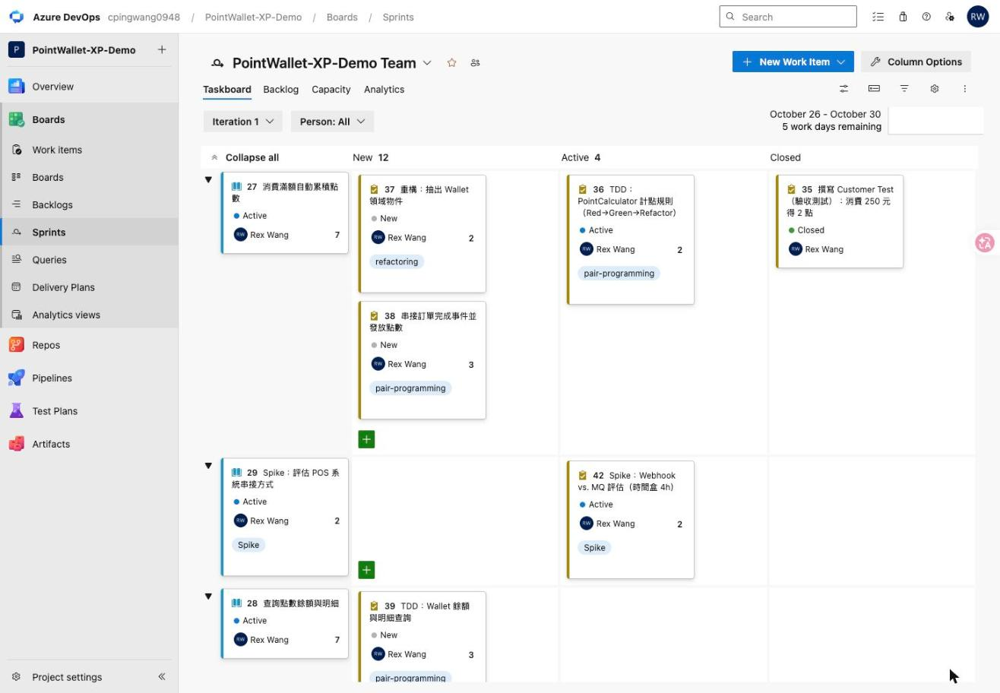

### Step 5.2 自訂 Board 欄位：WIP 限制與欄位完成定義

**Boards › Boards**（User Story 層級的看板）右上角齒輪 › **Columns**：

1. 把 `Active` 欄位改名為 **Develop (Pair + TDD)**
2. **WIP limit** = **3**：同時進行的故事不超過 3 個，鼓勵「先完成、再開始」
3. 勾選 **Split column into Doing and Done**：區分「還在做」與「做完等待下一步」
4. **Definition of done**：寫下離開此欄位的條件（滑鼠移到欄位標題的 ⓘ 就能看到）

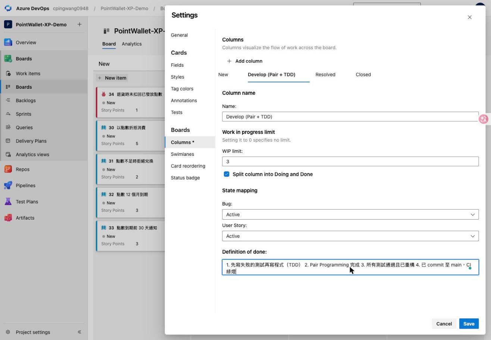

儲存後的看板：欄位標題 `3/3` 表示已達 WIP 上限；卡片下方 `1/4` 表示 4 個 Task 已完成 1 個：

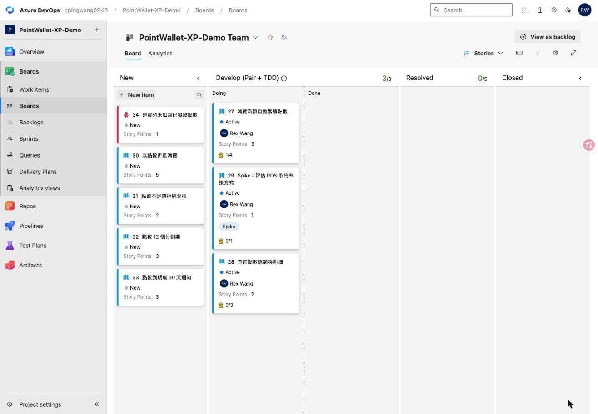

---

## 6. 測試先行（TDD）× 結對程式設計

> **XP 情境**：兩位開發者坐在一起（或用 VS Code Live Share 遠端結對），一人是 **Driver**（打字）、一人是 **Navigator**（思考方向、審查），每 25 分鐘交換。他們以 **Red → Green → Refactor** 的節奏完成 User Story #27。

### Step 6.1 認識 Repos

**Repos › Files** 是程式碼瀏覽器：左側樹狀結構、右側內容，可切換 **History**（檔案歷史）、**Compare**、**Blame**（逐行作者）。

本教材的 [`sample-app/`](sample-app/) 結構：

```
sample-app/
├── src/pointCalculator.js   # 計點規則（US #27）
├── src/wallet.js            # 錢包餘額與明細（US #28）
├── test/*.test.js           # 單元測試（Node.js 內建 node:test，無外部套件）
├── azure-pipelines.yml      # CI/CD
└── package.json
```

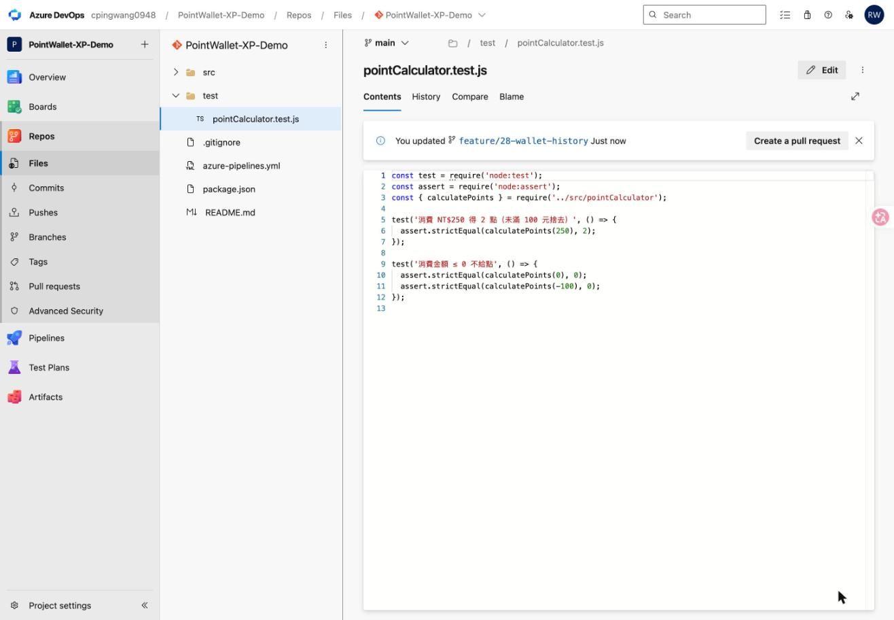

> 💡 推送程式碼：`git remote add origin https://<org>@dev.azure.com/<org>/<project>/_git/<repo>` 後 `git push -u origin main`。HTTPS 驗證可用 **Repos › Files › Generate Git Credentials**，或安裝 Git Credential Manager。

### Step 6.2 TDD 的節奏記錄在 Commit 歷史中

XP 團隊用 commit 訊息標記 TDD 的每一步，讓「測試先行」**看得見、可稽核**。在本機依序執行：

```bash
# 🔴 RED：先寫一個會失敗的測試
git add test/pointCalculator.test.js
git commit -m "test(#27): RED - 消費 250 元應得 2 點"     # npm test → 失敗（尚無實作）

# 🟢 GREEN：寫「剛好」讓測試通過的程式
git add src/pointCalculator.js
git commit -m "feat(#27): GREEN - 實作 calculatePoints

Co-authored-by: Pair Partner <pair.partner@example.com>"  # npm test → 通過

# 🔴 RED：下一條驗收條件「金額 ≤ 0 不給點」
git commit -am "test(#27): RED - 金額 ≤ 0 不應給點"       # -100 元會算出 -1 點 → 失敗
# 🟢 GREEN
git commit -am "feat(#27): GREEN - 處理非正數金額"
# 🔵 REFACTOR：測試保持綠燈的前提下改善設計
git commit -am "refactor(#27): 以 AMOUNT_PER_POINT 常數取代魔術數字"
git push
```

**Repos › Commits** 清楚呈現了 Red → Green → Refactor 的節奏：

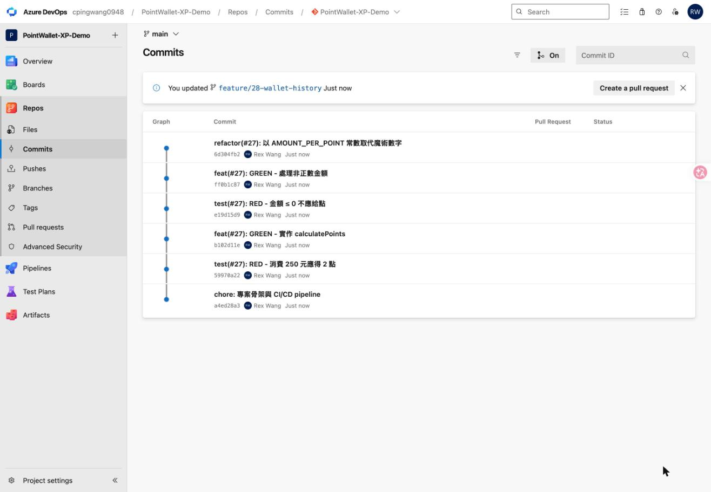

> 本教材每一步都實際驗證過：RED 的 commit 執行 `npm test` 會失敗、GREEN 與 REFACTOR 會通過。

### Step 6.3 檢視重構的差異

點擊 refactor commit，**Files** 頁籤顯示行層級差異：行為沒變（測試仍通過），只是把魔術數字 `100` 換成具名常數 —— 這就是 **Refactoring** 與 **Simple Design**：

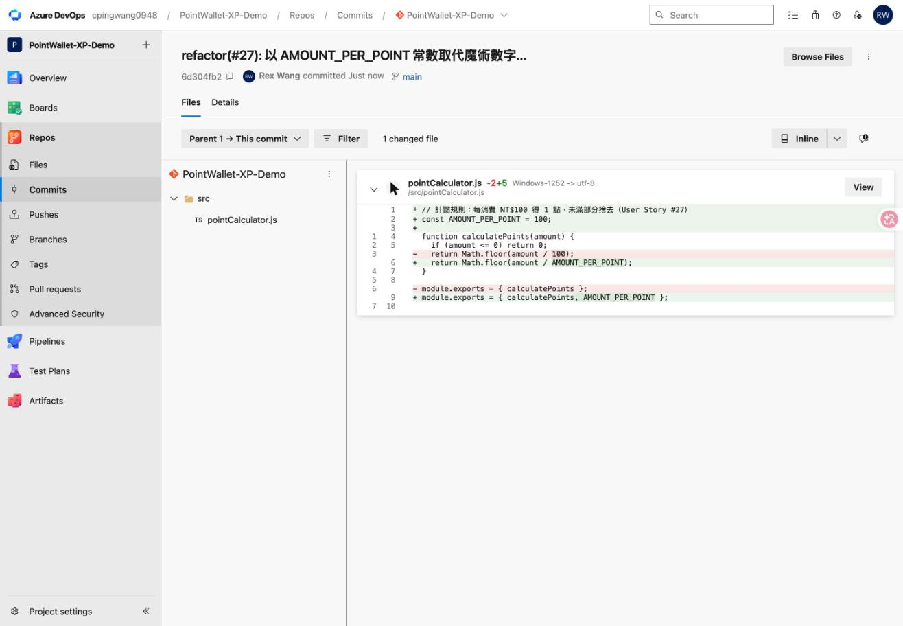

### Step 6.4 結對紀錄與 Work Item 連結

切換到 **Details** 頁籤：

- **Description**：commit 訊息中的 `#27` 被自動辨識為 User Story #27 的連結
- `Co-authored-by:` trailer 記錄了結對夥伴（Git 標準格式，ADO 會原樣保留在訊息中）
- **Work items**：此 commit 已連結到 User Story #27 —— 從故事也能反查到這個 commit

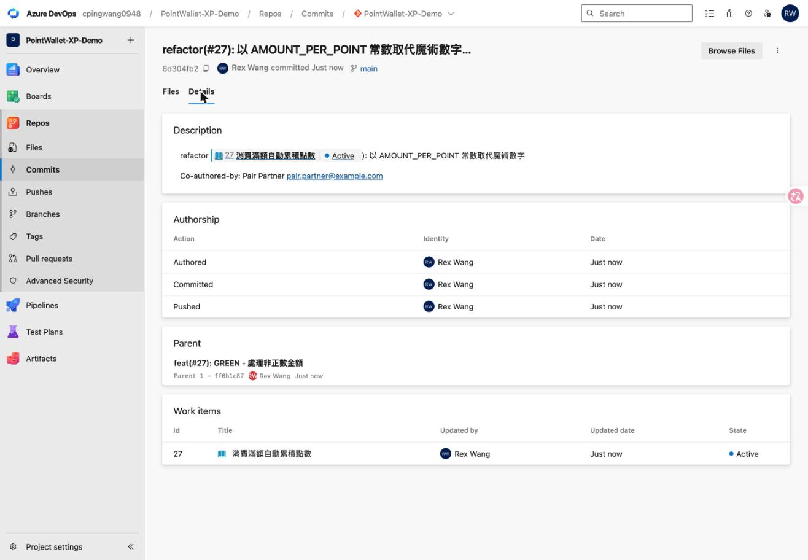

> 💡 ADO 沒有專門的「結對」欄位。實務上用 **commit trailer + Task Tag `pair-programming`** 兩者搭配，就能在 Queries 中統計結對比例（見 [Step 10.1](#step-101-queries追蹤-spike-重構與結對工作)）。

---

## 7. 持續整合與集體程式碼所有權

> **XP 情境**：XP 要求「每天整合數次」。團隊採 **主幹開發（Trunk-based）**：直接 commit 到 main，或使用**存活不超過一天**的短命分支。每次整合都由 CI 自動建置並執行全部測試。

### Step 7.1 CI/CD Pipeline 的 YAML

[`sample-app/azure-pipelines.yml`](sample-app/azure-pipelines.yml) 定義了兩個 **Stage**：

```yaml
trigger:
  branches:
    include: [main]          # 每次整合到 main 就觸發（Continuous Integration）

stages:
  - stage: Build             # 建置與測試
    jobs:
      - job: Test
        steps:
          - task: NodeTool@0
            inputs: { versionSpec: '22.x' }
          - script: npm run test:ci          # 同時輸出 JUnit 報告
          - task: PublishTestResults@2       # 測試結果顯示在 Pipeline 的 Tests 頁籤
            condition: succeededOrFailed()
            inputs: { testResultsFormat: JUnit, testResultsFiles: test-results.xml }

  - stage: DeployStaging     # 小版本發佈（第 8 章）
    dependsOn: Build
    condition: and(succeeded(), eq(variables['Build.SourceBranch'], 'refs/heads/main'))
    jobs:
      - deployment: Deploy
        environment: staging
        strategy: { runOnce: { deploy: { steps: [ { script: echo 部署 } ] } } }
```

### Step 7.2 建立 Pipeline

1. **Pipelines › Create Pipeline**
2. **Where is your code?** › **Azure Repos Git**
3. 選擇 Repository `PointWallet-XP-Demo`
4. ADO 偵測到 repo 中已有 `azure-pipelines.yml`，直接進入 **Review your pipeline YAML**
5. 點 **Run**

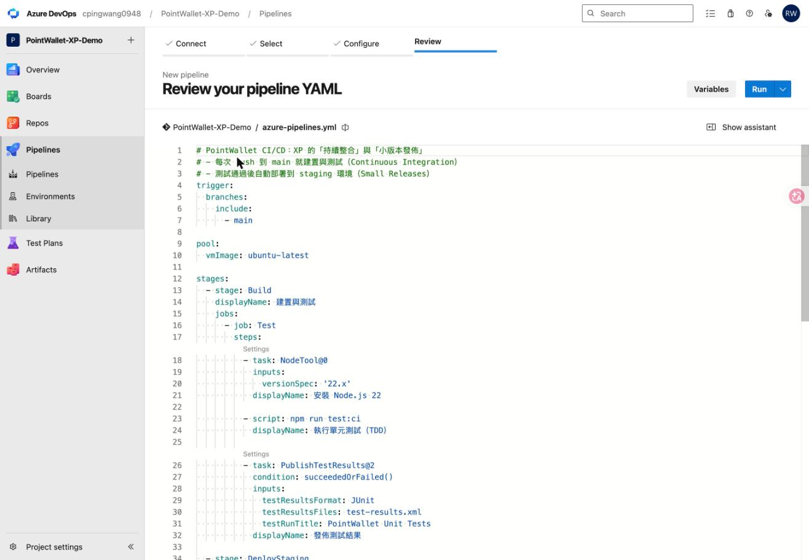

### Step 7.3 檢視執行結果

執行頁面上方的 **Related** 顯示「1 work items」—— Pipeline 自動追溯到這次建置包含的 User Story #27。下方 **Stages** 顯示兩個階段：`建置與測試` → `部署到 Staging`。

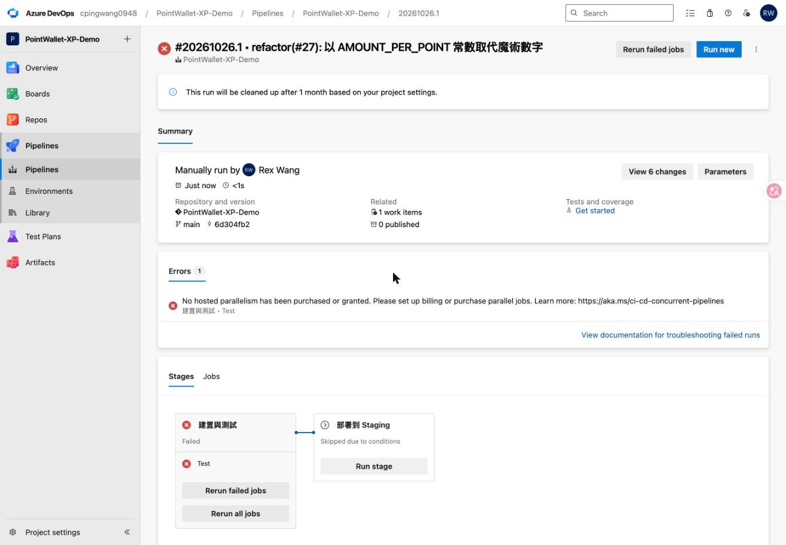

### Step 7.4 第一次執行常見錯誤：No hosted parallelism

上圖的錯誤訊息是新 Organization 最常見的狀況：

> *No hosted parallelism has been purchased or granted.*

原因是 **Organization settings › Pipelines › Parallel jobs** 中 Microsoft-hosted 的額度為 0（私有專案的 Self-hosted 則有 1 個免費平行作業）。解法：

| 方案 | 做法 | 優缺點 |
|---|---|---|
| A. 申請免費 Microsoft-hosted 額度 | 填寫 <https://aka.ms/azpipelines-parallelism-request> | 免維護；審核需數個工作天 |
| B. 自建 Self-hosted Agent | 執行 [`scripts/04-setup-self-hosted-agent.sh`](scripts/04-setup-self-hosted-agent.sh)，並把 YAML 的 `pool` 改為 `name: Default` | 立即可用；需自行維護主機 |
| C. 購買平行作業 | Organization settings › Billing | 適合正式團隊 |

> CI 無法執行時，XP 團隊會把它當成**最高優先的障礙**處理 —— 沒有 CI，就沒有「隨時可發佈」的信心。

### Step 7.5 短命分支 + Pull Request（選用）

主幹開發不代表不能用分支。User Story #28 的結對組合用一個 **只存活幾小時** 的分支 `feature/28-wallet-history` 完成，再發 PR 合併：

1. **Repos › Pull requests › New pull request**：`feature/28-wallet-history` → `main`
2. Description 記錄 TDD 步驟與結對資訊；**Work items to link** 自動帶入 User Story #28

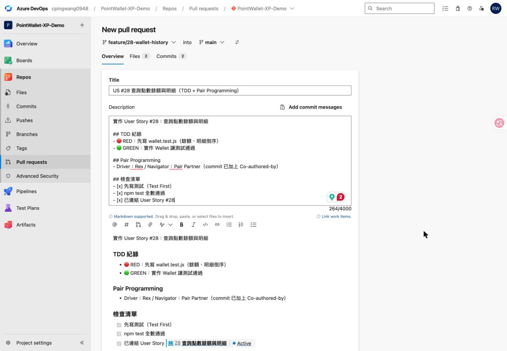

**Commits** 頁籤可看到這個分支同樣遵循 RED → GREEN：

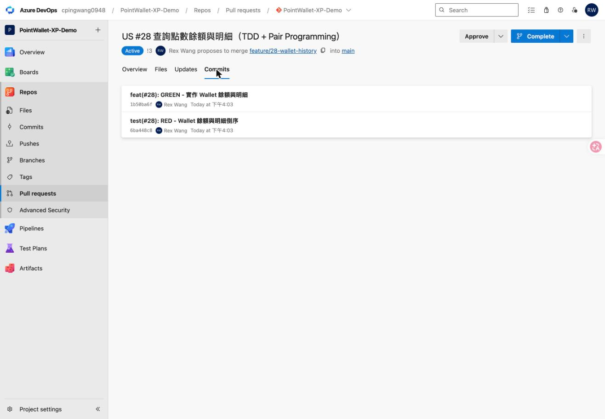

### Step 7.6 完成 PR：Rebase and fast-forward

點 **Complete**，**Merge type** 選 **Rebase and fast-forward**：把分支的 commit 依序接到 main 之後，維持**線性歷史**，最符合主幹開發的精神。勾選 **Delete feature/28-wallet-history after merging**，讓分支「用完即丟」。

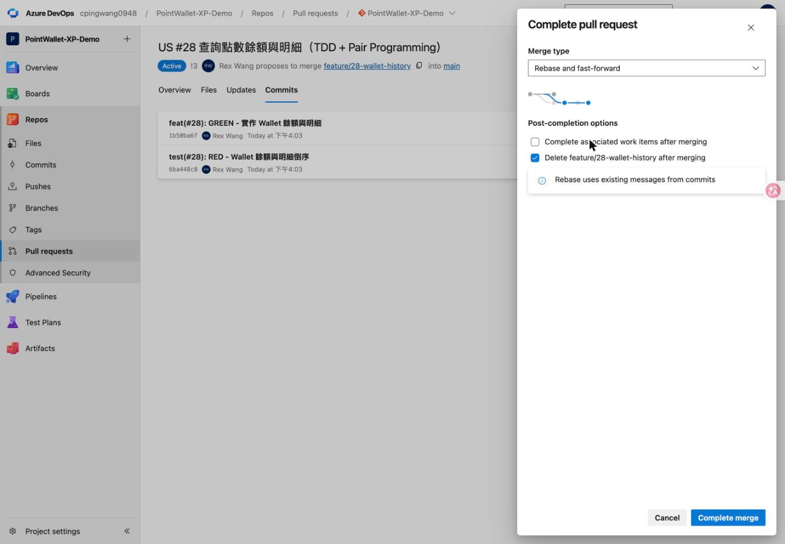

> **為什麼這裡沒有要求 Reviewer 核准？** XP 的結對程式設計本身就是**即時的 Code Review**（Navigator 全程審查），因此許多 XP 團隊不在 PR 上再設必要審查者，而是靠 **Build Validation**（CI 必須通過）把關。這也體現 **Collective Code Ownership**：任何人都能修改、合併任何程式碼，不設專屬擁有者。
> 若組織的合規要求必須有審查紀錄，可在 **Branch policies** 開啟 *Require a minimum number of reviewers*。

合併後 CI 自動觸發（`Individual CI`），**Pipelines › Runs** 可看到每一次整合的結果：

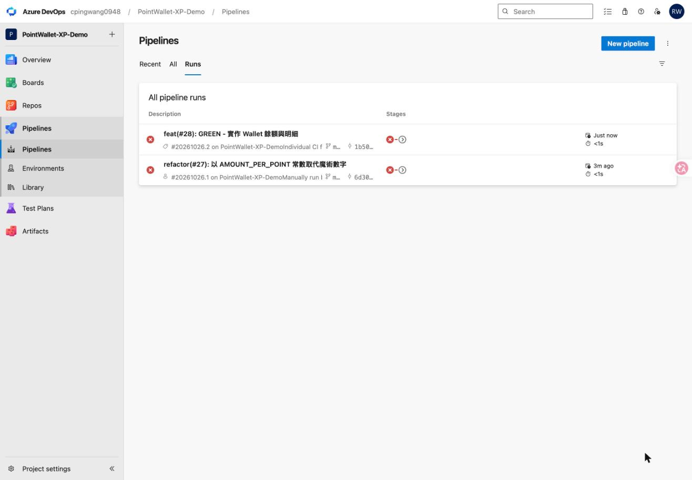

> CI 可執行後，請到 **Repos › Branches › main › Branch policies › Build Validation** 加入此 Pipeline，讓「CI 綠燈」成為合併的硬性條件。

---

## 8. 小版本發佈：Environment 與部署階段

> **XP 情境**：**Small Releases**：每個 Iteration 至少把可運作的軟體交到客戶手上一次。團隊每次 main 綠燈就自動部署到 `staging`，客戶隨時可以試用。

### Step 8.1 建立 Environment

1. **Pipelines › Environments › Create environment**
2. **Name**：`staging`；**Description**：用途說明
3. **Resource**：`None`（之後可加入 Kubernetes 或虛擬機）

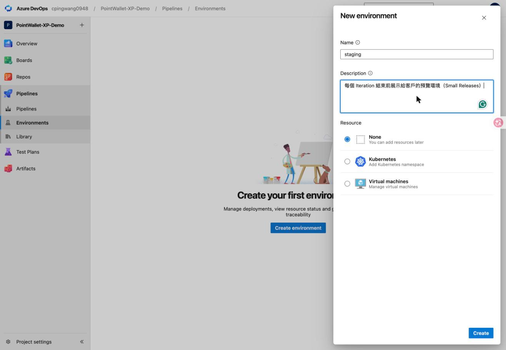

YAML 中的 `environment: staging` 會對應到這個 Environment，**Deployments** 頁籤會記錄每次部署是哪個 Pipeline、哪些 commit、哪些 Work Item。

### Step 8.2 加上部署檢查（Approvals and checks）

在 Environment 的 **Approvals and checks** 頁籤可加入：

| 檢查 | 用途 |
|---|---|
| **Branch control** | 只允許特定分支部署（本例：`refs/heads/main`） |
| Approvals | 部署前需指定人員核准（例如正式環境由客戶核准） |
| Business Hours | 只在上班時間部署 |

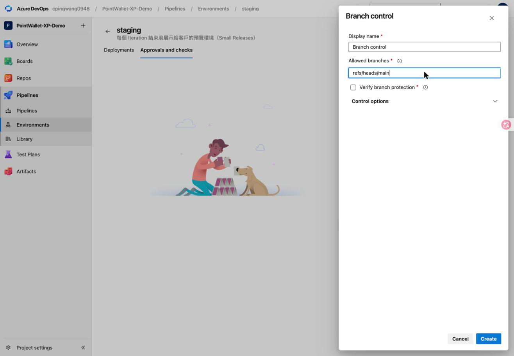

> XP 的 staging 部署通常**完全自動**（不設人工核准），以縮短回饋時間；人工核准留給正式環境。

---

## 9. 客戶驗收測試（Customer Tests）

> **XP 情境**：XP 的 **On-site Customer** 不只寫故事，也負責定義「怎樣才算完成」。Acceptance Criteria 會變成 **Customer Test（驗收測試）**，在 staging 上執行；全部通過，故事才算完成。

### Step 9.1 建立 Test Case 並連結 User Story

1. 開啟 User Story #27 › **Related Work › Add link › New item**
2. **Link type**：`Tested By`；**Work item type**：`Test Case`
3. 在 **Steps** 頁籤逐步輸入 **Action** 與 **Expected result**
4. 加上 Tag `customer-test`，方便查詢

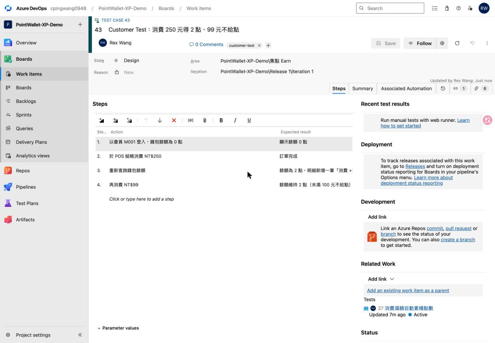

右下角 **Tests** 顯示它驗證的是 User Story #27 —— 需求與驗收測試的追溯關係就此建立。

> 💡 **Test Plans** 服務可把 Test Case 組成 Test Plan / Suite 並在瀏覽器中逐步執行、記錄 Pass/Fail、失敗時直接開 Bug。完整功能需 **Basic + Test Plans** 授權（可試用 30 天）。
> 自動化的驗收測試（例如 Playwright、Cucumber）也可以透過 Pipeline 的 `PublishTestResults` 回報，並在 Test Case 的 **Associated Automation** 頁籤關聯。

---

## 10. 回饋與改善：Queries、Dashboard、Wiki

### Step 10.1 Queries：追蹤 Spike、重構與結對工作

**Boards › Queries › New query**，建立共用查詢（Shared Queries）：

| 查詢 | 條件 |
|---|---|
| XP - Spike 與重構工作 | `Tags Contains Spike` **Or** `Tags Contains refactoring` |
| XP - 目前 Iteration 的 Pair Programming 工作 | `Work Item Type = Task` And `Tags Contains pair-programming` And `Iteration Path = @CurrentIteration` |

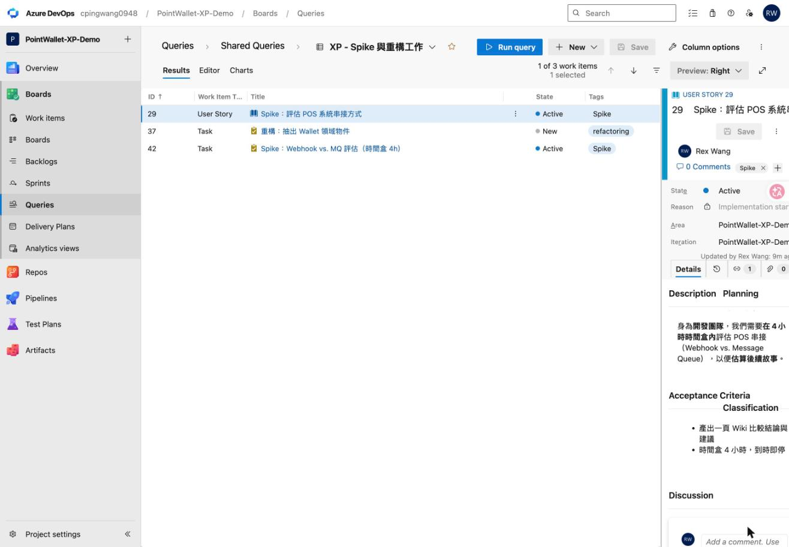

> 若「重構」類工作長期為 0，代表技術債正在累積；若 Spike 過多，代表故事拆得太大或技術風險太高。這些都是 Iteration 回顧的好話題。

### Step 10.2 Dashboard：資訊看板

**Overview › Dashboards › Add a widget**，本教材加入三個 Widget：

| Widget | XP 用途 |
|---|---|
| **Velocity** | 每個 Iteration 計畫 vs. 完成的工作量，作為下次 Planning 的「昨日天氣」 |
| **Build History** | CI 的紅綠燈歷史 —— 紅燈要立刻修 |
| **Sprint Burndown** | Iteration 內剩餘工時的燃盡趨勢 |

> Build History 需點 **Configure widget** 選擇 Pipeline。

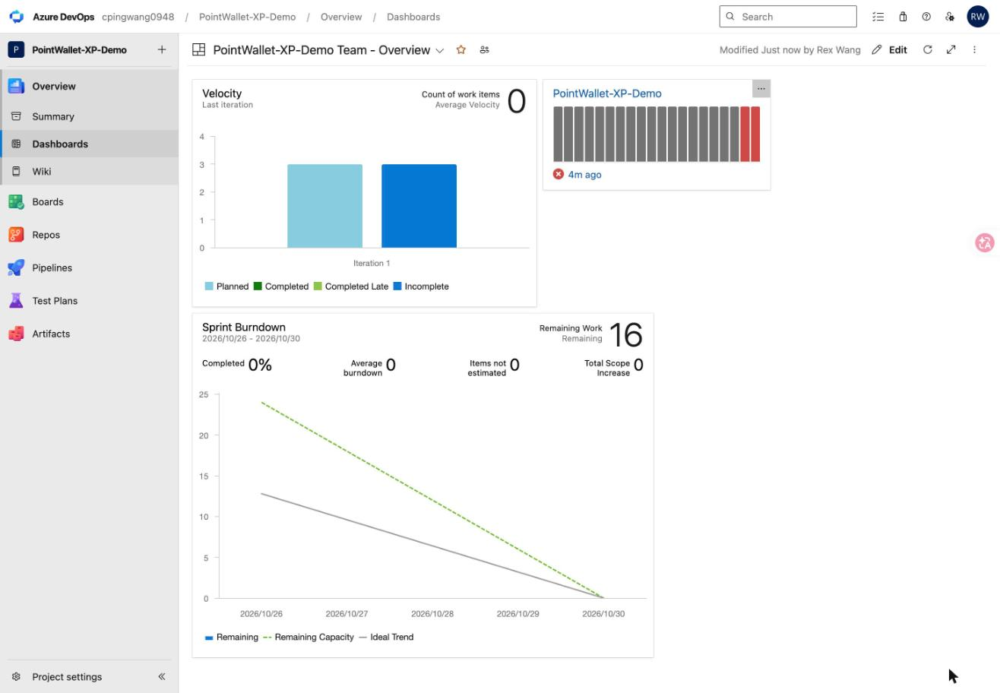

> 把 Dashboard 投影在團隊區域的大螢幕上，就是 XP 所說的 **Informative Workspace**；客戶以 Stakeholder 授權也能隨時查看。

### Step 10.3 Wiki：隱喻、團隊約定、Spike 結論

**Overview › Wiki › Create project wiki**。XP 團隊的 Wiki 通常包含：

- **System Metaphor**（系統隱喻）：本例把點數錢包比喻成「存摺」，讓客戶與開發使用同一套語言
- **XP 團隊工作約定**：每個 XP 實踐如何在 ADO 中落實
- **Coding Standard**：XP 要求全隊遵循一致的程式風格，讓集體所有權可行
- **Spike 結論**、**Iteration 回顧**

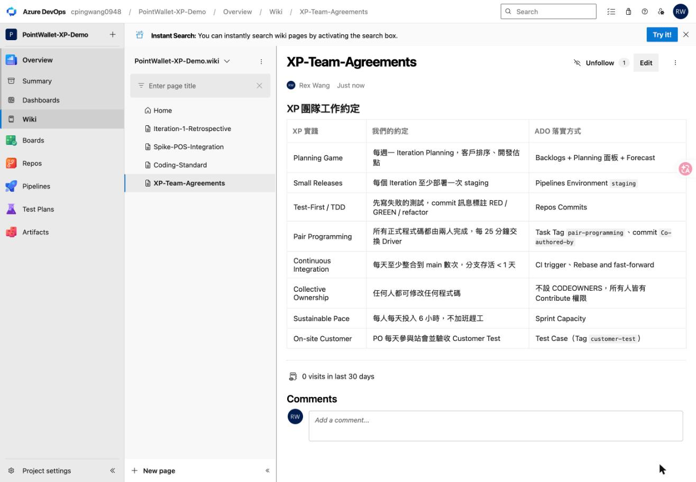

Spike #29 的結論頁面，記錄比較結果與對估點的影響：

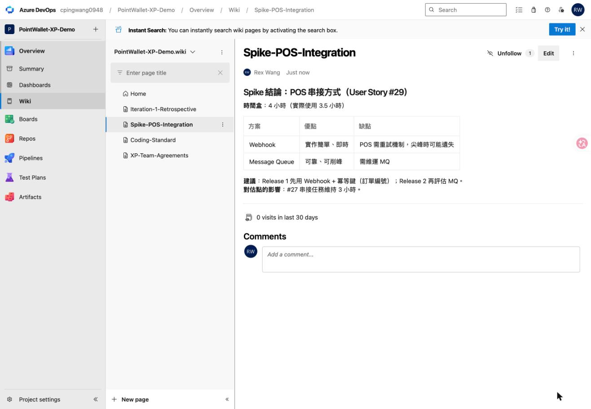

> 所有頁面的 Markdown 原始檔都在 [`wiki-pages/`](wiki-pages/)，可直接匯入你的 Wiki。

### Step 10.4 Iteration 結束：回顧與下一輪

每週五 Iteration 結束時：

1. 客戶在 staging 執行 Customer Test，通過的 User Story 改為 **Closed**
2. 未完成的故事拖回 Backlog 或下一個 Iteration，由客戶重新排序
3. 依實際完成的 Story Points 更新 Forecast 的速度
4. 回顧（Retrospective）紀錄寫進 Wiki，行動項目建成 Task 排入下個 Iteration

專案首頁 **Overview › Summary** 的 **Project stats** 提供本週整體活動的快照：建立 / 完成的 Work Item、PR、commit 數與建置成功率：

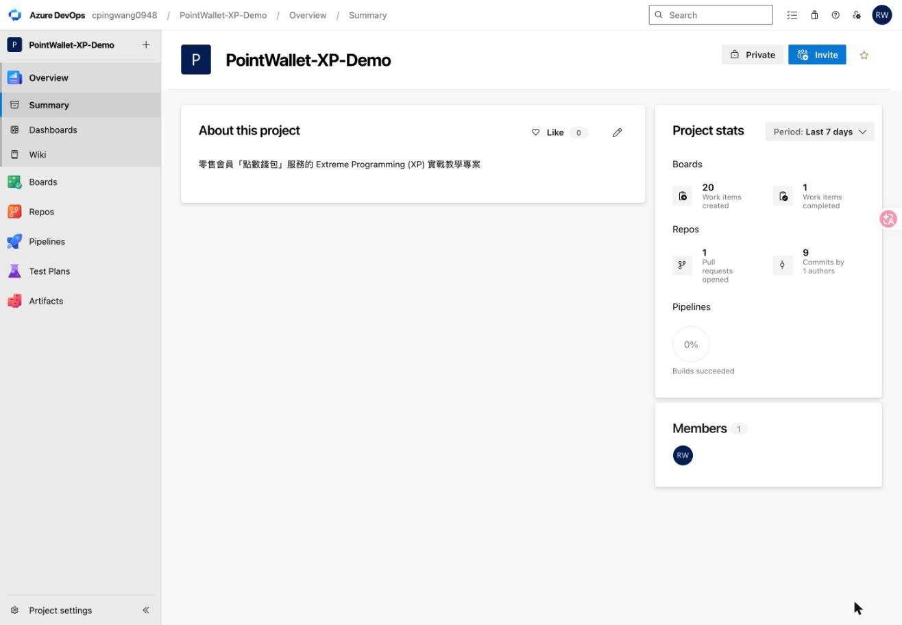

---

## 11. 清理環境

1. **Project settings › General › Overview** 最下方 **Delete**，輸入專案名稱確認
2. 或執行 [`scripts/99-cleanup.sh`](scripts/99-cleanup.sh)

> ⚠️ 刪除的專案 **28 天內**可在 **Organization settings › Projects** 還原，之後永久刪除。

---

## 附錄 A：用腳本重建本教材環境

```
.
├── README.md                  # 本教材
├── images/                    # 截圖
├── sample-app/                # 範例程式（Node.js 22+，無外部相依）
│   ├── src/pointCalculator.js
│   ├── src/wallet.js
│   ├── test/pointCalculator.test.js
│   ├── test/wallet.test.js
│   ├── azure-pipelines.yml    # CI + 部署 staging
│   └── package.json
├── scripts/
│   ├── 00-env.sh              # 共用變數、az devops 預設值、REST 輔助函式
│   ├── 01-create-project.sh   # Agile 專案、Release/Iteration、Area、Bug 行為、容量
│   ├── 02-seed-backlog.sh     # Feature / User Story / Spike / Bug / Task
│   ├── 03-setup-repo-pipeline.sh  # 推送程式、staging 環境、Pipeline、Wiki
│   ├── 04-setup-self-hosted-agent.sh  # （選用）Self-hosted Agent
│   └── 99-cleanup.sh          # 刪除專案
└── wiki-pages/                # 系統隱喻、XP 約定、Coding Standard、Spike、回顧範本
```

**前置需求**：[Azure CLI](https://learn.microsoft.com/cli/azure/install-azure-cli)、Git、Python 3、Node.js 22+（本機測試）。

```bash
az login
export ADO_ORG=https://dev.azure.com/<your-org>
export ADO_PROJECT=PointWallet-XP-Demo

bash scripts/01-create-project.sh
bash scripts/02-seed-backlog.sh
bash scripts/03-setup-repo-pipeline.sh

# 本機跑測試
cd sample-app && npm test
```

> - 腳本使用 `azure-devops` CLI 擴充套件；CLI 未涵蓋的設定（團隊 Bug 行為、容量、Environment）透過 `00-env.sh` 的 `ado_rest` 呼叫 REST API。
> - Board 欄位（WIP、Split column）與 Dashboard Widget 請依第 5、10 章於網頁設定。
> - 想重現逐步 TDD 的 commit 歷史，請依 [Step 6.2](#step-62-tdd-的節奏記錄在-commit-歷史中) 手動練習 —— 這正是 TDD Kata 的價值。

---

## 附錄 B：常見問題

| 問題 | 原因 / 解法 |
|---|---|
| Bug 沒出現在 Backlog | Agile 範本預設 *Bugs are managed with tasks*，改為 *with requirements*（Step 2.5） |
| Iteration 沒出現在 Sprints 頁面 | 未設定日期，或未在 Team configuration › Iterations 中選取 |
| 新增的 Feature 跑進目前 Iteration | Default iteration 為 `@CurrentIteration`，請手動改為 `Release 1` |
| Task 改成 Closed 時出現 `TF401320 ... Remaining Work` | 規則要求 Task 關閉時 Remaining Work 為空（API / CLI 更新時需一併移除該欄位） |
| Commit 訊息的 `#27` 沒有連結 | 確認 Work Item ID 存在於同一 Organization；Repos 設定中的 commit mention linking 未被關閉 |
| Pipeline 出現 *No hosted parallelism* | 見 [Step 7.4](#step-74-第一次執行常見錯誤no-hosted-parallelism) |
| Forecast 分界線不準 | 速度是輸入值，請依 Velocity 圖的實際完成點數調整 |

---

## 附錄 C：參考資料

- [Agile process work item types and workflow](https://learn.microsoft.com/azure/devops/boards/work-items/guidance/agile-process-workflow)
- [Forecast your product backlog](https://learn.microsoft.com/azure/devops/boards/sprints/forecast)
- [Manage columns on your board（WIP、Split column、Definition of done）](https://learn.microsoft.com/azure/devops/boards/boards/add-columns)
- [Link work items to commits and pull requests](https://learn.microsoft.com/azure/devops/boards/backlogs/connect-work-items-to-git-dev-ops)
- [Create and target an environment](https://learn.microsoft.com/azure/devops/pipelines/process/environments)
- [Microsoft-hosted 平行作業與免費額度](https://learn.microsoft.com/azure/devops/pipelines/licensing/concurrent-jobs)
- [Azure DevOps CLI](https://learn.microsoft.com/azure/devops/cli/)
- Kent Beck,《Extreme Programming Explained: Embrace Change》第二版
